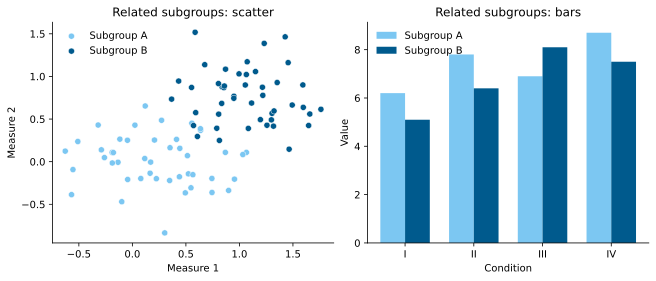

# Veen–Clark palette

An Okabe–Ito-derived categorical colour palette for scientific
figures by Roland J. Veen and Charlie Clark. The palette preserves five
Okabe–Ito colours and updates yellow to `#F5E600`. It separates two related
subgroups by making sky blue lighter and blue darker.

**Version 0.1.0.** Computational evaluation is condition-specific. The palette
has not been validated in a controlled participant study.

## Colours

| Name | Hex | RGB (8-bit) | RGB triplet (0–1) |
|---|---:|---:|---:|
| Orange | `#E69F00` | `(230, 159, 0)` | `(0.901961, 0.623529, 0.000000)` |
| Sky blue | `#7CC7F2` | `(124, 199, 242)` | `(0.486275, 0.780392, 0.949020)` |
| Bluish green | `#009E73` | `(0, 158, 115)` | `(0.000000, 0.619608, 0.450980)` |
| Yellow | `#F5E600` | `(245, 230, 0)` | `(0.960784, 0.901961, 0.000000)` |
| Blue | `#005A8D` | `(0, 90, 141)` | `(0.000000, 0.352941, 0.552941)` |
| Vermillion | `#D55E00` | `(213, 94, 0)` | `(0.835294, 0.368627, 0.000000)` |
| Reddish purple | `#CC79A7` | `(204, 121, 167)` | `(0.800000, 0.474510, 0.654902)` |
| Black | `#000000` | `(0, 0, 0)` | `(0.000000, 0.000000, 0.000000)` |

The order follows the commonly reproduced Okabe–Ito palette. The two blues
form a declared `blue_family` for related subgroups in scatter and bar charts.
When category identification is critical, also use marker shape, line style,
direct labels, hatching, or another redundant cue.

## Use

Ready-to-copy definitions are generated in [`exports/`](exports/) for:

- Python (Matplotlib and seaborn)
- R (ggplot2)
- MATLAB
- Julia (Makie and Plots)
- JavaScript (including D3)
- CSS custom properties

[`palettes/veen-clark.yaml`](palettes/veen-clark.yaml) is
the sole authoritative definition and the direct PaletteBench input.
[`palette.json`](palette.json) and every file in `exports/` are generated from
that YAML. You can copy the definitions without installing PaletteBench.
For example, from the repository root in Python:

```python
from exports.veen_clark import HEX, NAMES
colours = dict(zip(NAMES, HEX))
```

Use Python 3.12 and Git:

```bash
python3 -m venv .venv
.venv/bin/python -m pip install -r requirements-dev.txt
.venv/bin/python tools/rebuild_all.py --check
```

On Windows, replace `.venv/bin/python` with `.venv\Scripts\python.exe`.
To rebuild exports, examples, both evaluations and the PDF from the YAML:

```bash
.venv/bin/python tools/rebuild_all.py
```

The rebuild stages and validates outputs before replacing the listed generated
files. `--check` validates the committed artifacts without regenerating the
analyses: input hashes, exports, report metrics, local README links, and PDF
content and deterministic assembly. It does not compare figure pixels across
platforms. See [reproducibility](docs/reproducibility.md) and
[contributing](CONTRIBUTING.md) for details.

## PaletteBench evaluation

The palette is compared directly with the bundled Okabe–Ito baseline using
[PaletteBench v0.1.0](https://github.com/rolandveen/palettebench/tree/v0.1.0).
PaletteBench reports condition-specific CIEDE2000 separation under normal
vision, simulated protan/deutan/tritan colour-vision deficiencies, and
grayscale. Results are reported separately for each condition.

The committed evaluation artifacts are generated with:

```bash
.venv/bin/python -m palettebench compare --okabe-ito-baseline \
  palettes/veen-clark.yaml \
  --output tmp/comparison
```

The report, exact input copies, hashes, configuration, dependency versions,
figures, and full-precision data live together under `reports/`. Simulation and
colour-difference metrics support an assessment; they do not replace testing
with people who have colour-vision deficiencies or testing the actual figure
at its intended mark size and reproduction medium.

A single paginated report containing the baseline comparison, CVD overview,
grayscale, severity progressions, heatmaps, all four diagonal split pair
matrices, grouped-blue analysis, and limitations is available as
[`output/pdf/veen-clark-palette-0.1.0-report.pdf`](output/pdf/veen-clark-palette-0.1.0-report.pdf).
Rebuild it with `.venv/bin/python tools/build_pdf_report.py`.

### Computational results

For the intended blue subgroup pair, PaletteBench reports an increase in
modelled separation from ΔE00 22.31 to 37.92 under normal vision. The increase
persists under the standard simulations: 20.75 to 36.03 (protan 100%), 22.45
to 38.57 (deutan 100%), 19.95 to 35.08 (tritan 100%), and 21.62 to 37.43 in
grayscale. Other colour pairs show smaller increases or decreases in separation.

Relative to Okabe–Ito, the palette raises the 10th-percentile separation under normal
vision by 2.73 and the minimum under protan 100% by 3.56, while some individual
pairs lose separation—most notably blue/vermillion under tritan 100% (−12.20)
and blue/black under the reported conditions. See the
[`PaletteBench comparison report`](reports/v0.1.0/comparison/report.md) for all pairwise changes.

The yellow choice was motivated by informal presentation feedback, rather than a
controlled study. Its comparisons with orange and bluish green and its contrast
against white are included in the PDF. The [comparison](reports/v0.1.0/comparison/report.md)
and [audit](reports/v0.1.0/audit/report.md) contain exact release input copies and
record their hashes. See the [version notes](docs/releases/0.1.0.md).

## Plot examples



Both subgroups use circular markers and solid bar fills. The example uses
synthetic data to illustrate the colours; it is not a test of discriminability.
The reproducible source is [`examples/blue_subgroups.py`](examples/blue_subgroups.py).

## Provenance and citation

This palette is derived from the colour-universal-design palette developed by
Masataka Okabe and Kei Ito. Bang Wong brought the palette to a broad scientific
audience in a 2011 *Nature Methods* column; a 2023 author correction added the
missing link to the Okabe–Ito presentation. See [`REFERENCES.bib`](REFERENCES.bib).

If you use this palette, cite this repository using
[`CITATION.cff`](CITATION.cff), cite PaletteBench for the exact release used,
and retain the Okabe–Ito and Wong provenance.

For convenience, copy this plain-text citation:

```text
Veen RJ, Clark C. Veen-Clark palette [software]. Version 0.1.0. 2026.
Available from: https://github.com/rolandveen/veen-clark-palette
```

For EndNote, download [`CITATION.ris`](CITATION.ris) and select
[Reference Manager (RIS)](https://docs.endnote.com/docs/endnote/2025/v1/macos/en/content/08import/import_options.htm)
as the import option. The file is generated from `CITATION.cff` and includes
the authors, title, version, year and repository URL.

## Responsible use of AI

This repository is the product of human-led research and development. The **conceptualisation, research objectives, scientific contributions, methodological choices, experimental design, interpretation of results, and conclusions** are determined by the human authors, who retain full intellectual and scientific responsibility for the work.

Generative artificial intelligence (AI) tools, such as ChatGPT and Codex, may be employed as **assistants** in software development and documentation. Their contributions may include implementing human-defined designs, suggesting or refactoring code, debugging, developing tests, improving documentation, exploring technical alternatives, and providing critical feedback. AI-generated suggestions are treated as provisional and are subject to human review, modification, and appropriate verification before adoption.

**AI assistance does not constitute scientific authorship or transfer responsibility.** The human authors remain accountable for the correctness, originality, scientific integrity, reproducibility, attribution, licensing, and maintenance of the work. AI-generated outputs are not regarded as independent scientific evidence, and AI systems are not credited as authors or co-authors.

Where AI tools are employed as part of the scientific methodology itself, rather than merely as development assistants, their role is documented separately as appropriate to ensure transparency and reproducibility.

## References

1. Okabe, M., and Ito, K. (2002). [How to make figures and presentations that are friendly to color blind people](https://jfly.uni-koeln.de/html/color_blind/). [Original brochure (PDF)](https://jfly.uni-koeln.de/html/manuals/pdf/color_blind.pdf).

2. Wong, B. (2011). [Points of view: Color blindness](https://doi.org/10.1038/nmeth.1618). *Nature Methods*, **8**(6), 441.

3. Wong, B. (2023). [Author Correction: Points of view: Color blindness](https://doi.org/10.1038/s41592-023-01974-0). *Nature Methods*, **20**(8), 1266.

4. Veen, R. J. (2026). [PaletteBench (v0.1.0)](https://doi.org/10.5281/zenodo.23071831) [Software]. Zenodo. [Source code for v0.1.0](https://github.com/rolandveen/palettebench/tree/v0.1.0).

## License

BSD 3-Clause. Copyright © 2026 Roland J. Veen and Charlie Clark.
