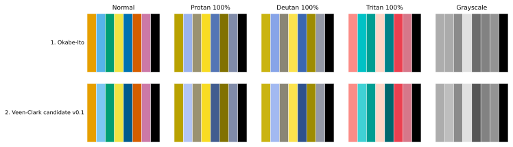
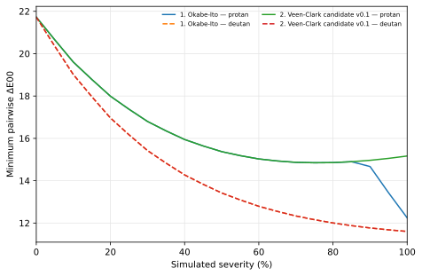
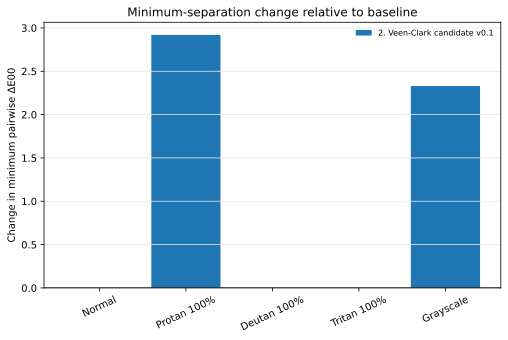

# Palette comparison

Baseline (palette 1): **Okabe-Ito**

Positive Δ values mean greater modelled separation than the baseline; negative values mean reduced modelled separation. Results are reported separately for each condition. Zero change means the minimum separation is unchanged.

## Condition-level results

| Palette # | Palette | Condition | Severity | Minimum ΔE00 | Δ minimum | 10th percentile | Δ 10th percentile | Weakest pair | Mean | Δ mean | Median | Δ median | Maximum | SD |
| --- | --- | --- | --- | --- | --- | --- | --- | --- | --- | --- | --- | --- | --- | --- |
| 1 | Okabe-Ito | normal | 0 | 21.73 | +0.00 | 30.98 | +0.00 | orange/yellow | 48.64 | +0.00 | 49.49 | +0.00 | 88.42 | 14.60 |
| 1 | Okabe-Ito | protan100 | 100 | 12.25 | +0.00 | 17.08 | +0.00 | blue/reddish_purple | 40.25 | +0.00 | 41.66 | +0.00 | 86.44 | 17.85 |
| 1 | Okabe-Ito | deutan100 | 100 | 11.61 | +0.00 | 15.83 | +0.00 | orange/yellow | 40.49 | +0.00 | 37.25 | +0.00 | 89.55 | 19.13 |
| 1 | Okabe-Ito | tritan100 | 100 | 10.87 | +0.00 | 13.42 | +0.00 | orange/reddish_purple | 43.75 | +0.00 | 49.79 | +0.00 | 83.86 | 20.01 |
| 1 | Okabe-Ito | grayscale | 0 | 0.60 | +0.00 | 5.37 | +0.00 | orange/sky_blue | 23.21 | +0.00 | 14.29 | +0.00 | 83.83 | 19.72 |
| 2 | Veen-Clark candidate v0.1 | normal | 0 | 21.73 | +0.00 | 33.71 | +2.73 | orange/yellow | 49.30 | +0.65 | 49.65 | +0.16 | 88.42 | 14.51 |
| 2 | Veen-Clark candidate v0.1 | protan100 | 100 | 15.17 | +2.92 | 18.08 | +1.00 | orange/yellow | 41.14 | +0.88 | 41.46 | -0.20 | 86.44 | 17.48 |
| 2 | Veen-Clark candidate v0.1 | deutan100 | 100 | 11.61 | +0.00 | 16.01 | +0.17 | orange/yellow | 41.36 | +0.86 | 37.53 | +0.27 | 89.55 | 19.17 |
| 2 | Veen-Clark candidate v0.1 | tritan100 | 100 | 10.87 | +0.00 | 15.79 | +2.37 | orange/reddish_purple | 44.52 | +0.77 | 52.05 | +2.26 | 83.86 | 19.06 |
| 2 | Veen-Clark candidate v0.1 | grayscale | 0 | 2.93 | +2.33 | 5.79 | +0.43 | bluish_green/reddish_purple | 26.08 | +2.86 | 20.65 | +6.36 | 83.83 | 19.94 |

Threshold count and fraction changes are included in the full-precision comparison data.

## Largest matched-pair changes

Pairs are matched by colour ID. Increased ΔE00 means greater modelled separation; decreased ΔE00 means reduced modelled separation. Two-sided matching coverage is recorded in [`data/pairwise_coverage.csv`](data/pairwise_coverage.csv) and [`data/pairwise_coverage.json`](data/pairwise_coverage.json), so palettes with added, removed, or renamed IDs are not silently treated as complete pairwise comparisons.

| Palette # | Palette | Condition | Diagnostic | Pair | Baseline ΔE00 | Palette ΔE00 | Change |
| --- | --- | --- | --- | --- | --- | --- | --- |
| 2 | Veen-Clark candidate v0.1 | normal | Largest increase | sky_blue / blue | 22.31 | 37.92 | +15.61 |
| 2 | Veen-Clark candidate v0.1 | normal | Largest increase | sky_blue / black | 60.95 | 68.99 | +8.04 |
| 2 | Veen-Clark candidate v0.1 | normal | Largest increase | orange / blue | 55.35 | 58.70 | +3.35 |
| 2 | Veen-Clark candidate v0.1 | normal | Largest decrease | blue / black | 39.23 | 31.50 | -7.73 |
| 2 | Veen-Clark candidate v0.1 | normal | Largest decrease | sky_blue / yellow | 57.53 | 52.81 | -4.72 |
| 2 | Veen-Clark candidate v0.1 | normal | Largest decrease | orange / sky_blue | 53.62 | 50.65 | -2.96 |
| 2 | Veen-Clark candidate v0.1 | protan100 | Largest increase | sky_blue / blue | 20.75 | 36.03 | +15.28 |
| 2 | Veen-Clark candidate v0.1 | protan100 | Largest increase | sky_blue / black | 64.00 | 71.85 | +7.85 |
| 2 | Veen-Clark candidate v0.1 | protan100 | Largest increase | blue / reddish_purple | 12.25 | 19.74 | +7.49 |
| 2 | Veen-Clark candidate v0.1 | protan100 | Largest decrease | blue / black | 41.34 | 32.85 | -8.50 |
| 2 | Veen-Clark candidate v0.1 | protan100 | Largest decrease | sky_blue / yellow | 53.32 | 49.72 | -3.60 |
| 2 | Veen-Clark candidate v0.1 | protan100 | Largest decrease | orange / sky_blue | 50.54 | 48.43 | -2.11 |
| 2 | Veen-Clark candidate v0.1 | deutan100 | Largest increase | sky_blue / blue | 22.45 | 38.57 | +16.12 |
| 2 | Veen-Clark candidate v0.1 | deutan100 | Largest increase | sky_blue / black | 58.62 | 66.62 | +8.00 |
| 2 | Veen-Clark candidate v0.1 | deutan100 | Largest increase | blue / reddish_purple | 25.25 | 32.03 | +6.78 |
| 2 | Veen-Clark candidate v0.1 | deutan100 | Largest decrease | blue / black | 38.23 | 31.06 | -7.18 |
| 2 | Veen-Clark candidate v0.1 | deutan100 | Largest decrease | sky_blue / yellow | 56.35 | 52.07 | -4.28 |
| 2 | Veen-Clark candidate v0.1 | deutan100 | Largest decrease | orange / sky_blue | 54.26 | 51.11 | -3.15 |
| 2 | Veen-Clark candidate v0.1 | tritan100 | Largest increase | sky_blue / blue | 19.95 | 35.08 | +15.13 |
| 2 | Veen-Clark candidate v0.1 | tritan100 | Largest increase | bluish_green / blue | 12.40 | 21.43 | +9.03 |
| 2 | Veen-Clark candidate v0.1 | tritan100 | Largest increase | sky_blue / black | 63.63 | 70.81 | +7.18 |
| 2 | Veen-Clark candidate v0.1 | tritan100 | Largest decrease | blue / vermillion | 65.67 | 53.47 | -12.20 |
| 2 | Veen-Clark candidate v0.1 | tritan100 | Largest decrease | blue / black | 41.46 | 33.20 | -8.25 |
| 2 | Veen-Clark candidate v0.1 | tritan100 | Largest decrease | sky_blue / yellow | 39.53 | 38.19 | -1.34 |
| 2 | Veen-Clark candidate v0.1 | grayscale | Largest increase | sky_blue / blue | 21.62 | 37.43 | +15.81 |
| 2 | Veen-Clark candidate v0.1 | grayscale | Largest increase | orange / blue | 22.20 | 33.09 | +10.89 |
| 2 | Veen-Clark candidate v0.1 | grayscale | Largest increase | yellow / blue | 34.37 | 44.61 | +10.24 |
| 2 | Veen-Clark candidate v0.1 | grayscale | Largest decrease | blue / black | 32.84 | 24.75 | -8.09 |
| 2 | Veen-Clark candidate v0.1 | grayscale | Largest decrease | sky_blue / yellow | 13.42 | 8.12 | -5.30 |

Full-precision summaries are in [`data/comparison.csv`](data/comparison.csv) and [`data/comparison.json`](data/comparison.json). Every matched pair is in [`data/pairwise_changes.csv`](data/pairwise_changes.csv) and [`data/pairwise_changes.json`](data/pairwise_changes.json). Reproducibility metadata is in [`metadata.json`](metadata.json), and exact input copies are in `inputs/`.
