# Veen-Clark candidate 2: palette audit

## Candidate 2 design rationale

Candidate 2 retains candidate 1's lighter sky blue (`#7CC7F2`) and darker blue (`#005A8D`) for related subgroups. It additionally replaces yellow `#F0E442` with `#F5E600`, aiming for a more distinct, less green, warmer-looking yellow that stands out more clearly in presentations.

Informal feedback from people with regular colour vision suggested that, in presentations where colour accuracy is low, the original yellow reads too much like green and does not stand out enough. This feedback motivated the revision; it was not a controlled participant study. The appearance descriptions express design intent, rather than a verified benefit across presentation devices.

PaletteBench measures ideal sRGB and specified CVD/grayscale simulations. It does not simulate projector colour errors or test audience perception. Greater pairwise separation does not establish greater visibility against a white slide background. The intended presentation benefit requires viewing comparisons under the intended conditions. See the PDF's yellow-specific table for changes in separation from orange and bluish green, alongside the retained blue analysis.

An experimental Okabe-Ito derivative that makes sky blue lighter and blue darker so the pair can encode related subgroups in scientific figures.

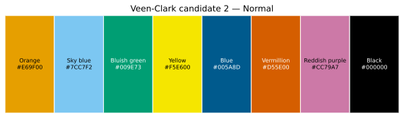

## Palette metadata

- Input: [`veen-clark-candidate-2.yaml`](inputs/01-veen-clark-candidate-2.yaml)
- Source: https://github.com/rolandveen/veen-clark-palette
- Colours: 8
- Machine-readable provenance: [`metadata.json`](metadata.json)

## Methodology and assumptions

Input values are interpreted as six-digit, gamma-encoded sRGB. For each simulated condition, sRGB values are transformed with Colorspacious's `sRGB1+CVD` model, which implements the Machado et al. model, then clipped to the displayable sRGB gamut. Display-bound sRGB is converted through CIE XYZ to CIE Lab using the sRGB D65 reference white. Pairwise differences use CIEDE2000 (ΔE00) from Colour Science for Python. Grayscale values preserve WCAG relative luminance. Condition-level clipping summaries are in [`metadata.json`](metadata.json) and [`data/conditions.csv`](data/conditions.csv); affected colours and their raw and clipped RGB values are in [`data/gamut_clipping.csv`](data/gamut_clipping.csv).

The simulated severity percentages are model parameters, not clinical measurements. Partial tritan simulations are supported by the underlying function but are omitted from the standard report because inherited tritan deficiency is rarer and severity interpolation has a less direct evidential basis than the primary red–green use case.

## Overview

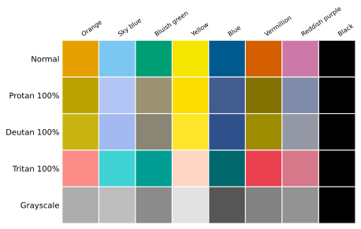

## Simulated CVD palette strips

### Protan 100%

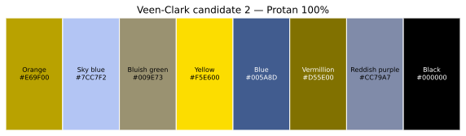

### Deutan 100%

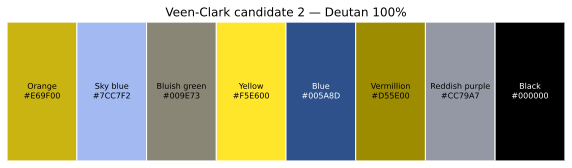

### Tritan 100%

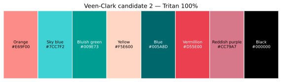

## Severity progressions

### Protan progression

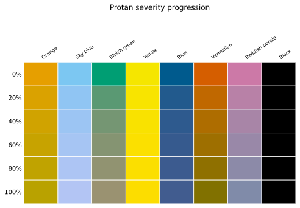

### Deutan progression

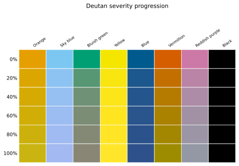

## Summary statistics

| Condition | Severity | Minimum ΔE00 | Pair | Maximum | Mean | Median | SD | 10th percentile |
| --- | --- | --- | --- | --- | --- | --- | --- | --- |
| normal | 0 | 22.04 | orange / yellow | 90.07 | 49.68 | 49.65 | 14.80 | 33.71 |
| protan20 | 20 | 18.43 | orange / yellow | 89.56 | 46.97 | 47.83 | 15.24 | 33.91 |
| protan40 | 40 | 16.50 | orange / yellow | 89.06 | 45.05 | 44.26 | 16.10 | 28.67 |
| protan60 | 60 | 15.66 | orange / yellow | 88.58 | 43.14 | 42.95 | 16.60 | 23.52 |
| protan80 | 80 | 15.51 | orange / yellow | 88.11 | 41.88 | 42.61 | 17.22 | 19.46 |
| protan100 | 100 | 15.81 | orange / yellow | 87.64 | 41.32 | 41.46 | 17.58 | 18.08 |
| deutan20 | 20 | 17.42 | orange / yellow | 90.31 | 46.89 | 47.93 | 15.66 | 33.41 |
| deutan40 | 40 | 14.86 | orange / yellow | 90.56 | 45.12 | 42.83 | 16.90 | 29.74 |
| deutan60 | 60 | 13.48 | orange / yellow | 90.82 | 43.37 | 40.27 | 17.67 | 23.95 |
| deutan80 | 80 | 12.74 | orange / yellow | 91.02 | 42.23 | 38.78 | 18.57 | 20.38 |
| deutan100 | 100 | 12.30 | orange / yellow | 91.11 | 41.70 | 37.53 | 19.35 | 16.01 |
| tritan100 | 100 | 10.87 | orange / reddish_purple | 83.99 | 44.53 | 52.05 | 19.04 | 15.79 |
| grayscale | 0 | 2.93 | bluish_green / reddish_purple | 85.02 | 26.21 | 20.88 | 20.05 | 5.79 |

Counts below the descriptive thresholds ΔE00 < 5, ΔE00 < 10, ΔE00 < 15, ΔE00 < 20 are available in `data/summary.csv`. No threshold is treated as a universal accessibility pass/fail criterion.

## Palette characteristics

| Colour | HEX | RGB | L* | Chroma | Relative luminance | Contrast white | Contrast black | Group |
| --- | --- | --- | --- | --- | --- | --- | --- | --- |
| Orange | #E69F00 | 230 159 0 | 70.61 | 76.48 | 0.4162 | 2.25 | 9.32 | — |
| Sky blue | #7CC7F2 | 124 199 242 | 77.01 | 30.81 | 0.5154 | 1.86 | 11.31 | blue_family |
| Bluish green | #009E73 | 0 158 115 | 57.74 | 47.49 | 0.2569 | 3.42 | 6.14 | — |
| Yellow | #F5E600 | 245 230 0 | 89.86 | 89.87 | 0.7601 | 1.30 | 16.20 | — |
| Blue | #005A8D | 0 90 141 | 36.43 | 34.62 | 0.0924 | 7.38 | 2.85 | blue_family |
| Vermillion | #D55E00 | 213 94 0 | 54.19 | 76.67 | 0.2215 | 3.87 | 5.43 | — |
| Reddish purple | #CC79A7 | 204 121 167 | 61.05 | 39.97 | 0.2930 | 3.06 | 6.86 | — |
| Black | #000000 | 0 0 0 | 0.00 | 0.00 | 0.0000 | 21.00 | 1.00 | — |

## Pairwise comparisons

The lower half of each pair matrix places two colours in direct diagonal contact; the upper half gives their ΔE00 value.

### Pairwise ΔE00 heatmaps

#### Normal

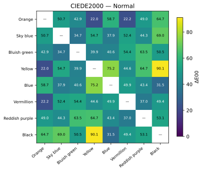

#### Protan 100%

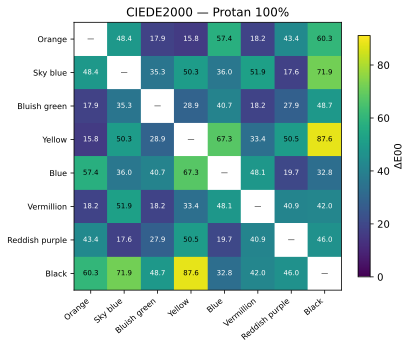

#### Deutan 100%

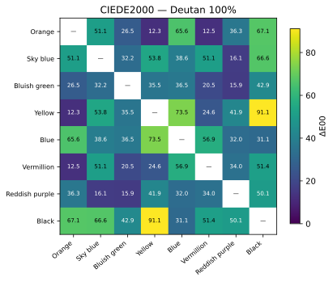

#### Tritan 100%

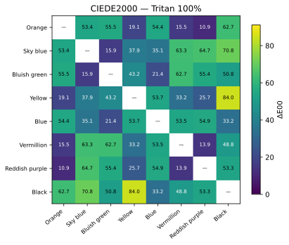

### Diagonal split pair matrices

#### Normal

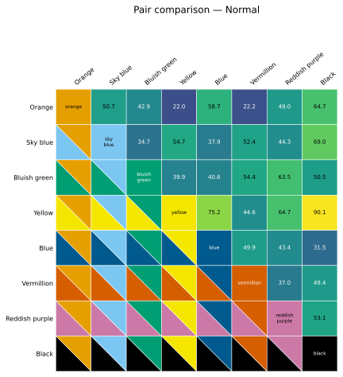

#### Protan 100%

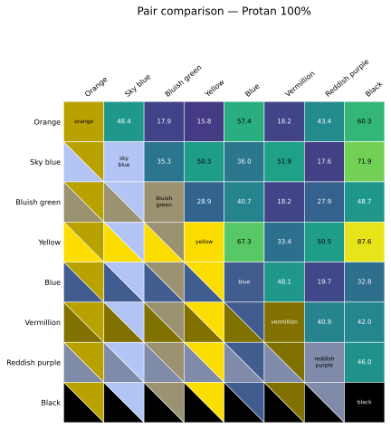

#### Deutan 100%

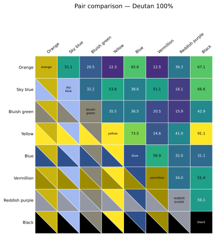

#### Tritan 100%

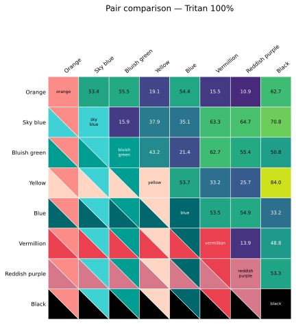

- [All pairwise data](data/pairwise.csv)

## Grouped-palette analysis

Pairs are classified as within-group, between-group, or ungrouped. Condition-level distributions are in [`data/group_summary.csv`](data/group_summary.csv), and each individual relationship is retained in [`data/pairwise.csv`](data/pairwise.csv). Minimum within-group and between-group distances are included in `data/summary.csv`.

| Condition | Severity | Relationship | Pairs | Minimum | Mean | Median | Maximum |
| --- | --- | --- | --- | --- | --- | --- | --- |
| normal | 0 | within | 1 | 37.92 | 37.92 | 37.92 | 37.92 |
| protan20 | 20 | within | 1 | 37.32 | 37.32 | 37.32 | 37.32 |
| protan40 | 40 | within | 1 | 36.87 | 36.87 | 36.87 | 36.87 |
| protan60 | 60 | within | 1 | 36.53 | 36.53 | 36.53 | 36.53 |
| protan80 | 80 | within | 1 | 36.26 | 36.26 | 36.26 | 36.26 |
| protan100 | 100 | within | 1 | 36.03 | 36.03 | 36.03 | 36.03 |
| deutan20 | 20 | within | 1 | 37.83 | 37.83 | 37.83 | 37.83 |
| deutan40 | 40 | within | 1 | 37.92 | 37.92 | 37.92 | 37.92 |
| deutan60 | 60 | within | 1 | 38.10 | 38.10 | 38.10 | 38.10 |
| deutan80 | 80 | within | 1 | 38.32 | 38.32 | 38.32 | 38.32 |
| deutan100 | 100 | within | 1 | 38.57 | 38.57 | 38.57 | 38.57 |
| tritan100 | 100 | within | 1 | 35.08 | 35.08 | 35.08 | 35.08 |
| grayscale | 0 | within | 1 | 37.43 | 37.43 | 37.43 | 37.43 |

## Weakest pairs and severity progression

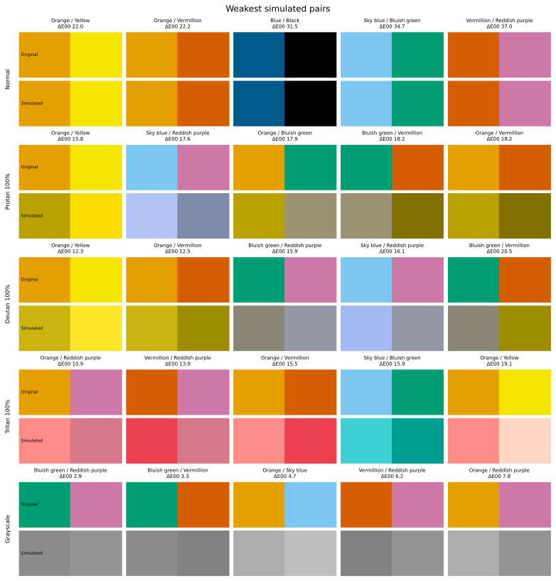

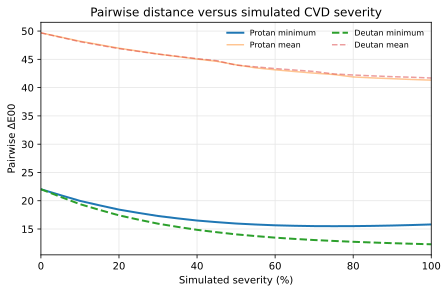

The identity of the minimum pair at each sampled severity is recorded in `data/severity_curves.csv`.

## Grayscale and lightness

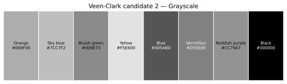

Grayscale is an additional robustness analysis; categorical palettes need not be fully discriminable by lightness alone when redundant encodings are provided.

## Caveats

Simulated CVD and perceptual-distance metrics support accessibility assessment, but they do not constitute validation with people who have CVD. Perception also depends on monitor calibration, viewing conditions, visual acuity, ageing, print reproduction, spatial context, and mark size. Colour should not be the sole carrier of critical information.

## Complete outputs

Requested figure formats (SVG, PDF, PNG) are in `figures/`; Markdown and booktabs LaTeX tables are in `tables/`; canonical CSV/JSON data, including gamut-clipping provenance, are in `data/`; and an exact copy of the input palette is in `inputs/`.
